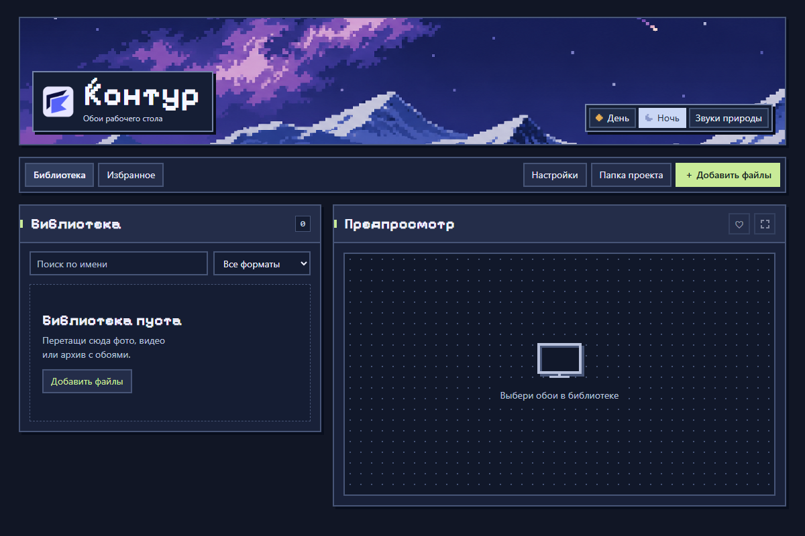

# Контур

Менеджер обоев для Windows. Используй свои фото, зацикленные видео и HTML-проекты. «Контур» размещает видео за значками рабочего стола и восстанавливает его при входе в Windows.

[Последний выпуск и установщики](../../releases/latest)

## Выпуски

| Выпуск | Установщик | Интерфейс |
| --- | --- | --- |
| Полный | `KonturSetup.exe` · около 98 МиБ | Пиксель-арт, дневная и ночная темы, падающие звёзды и звуки природы |
| Облегчённый | `KonturSetup-Lite.exe` · около 59 МиБ | Простой интерфейс без декоративных фонов, эффектов и звуков природы |

Ни в одном выпуске нет готовых обоев. В обоих работают библиотека, поиск, фильтры, избранное, полноэкранный предпросмотр и автозапуск. [Дневная тема](docs/screenshots/full-day.png) · [Облегчённый интерфейс](docs/screenshots/lite.png)

## Установка

1. Выбери один из установщиков для Windows x64 на странице [Releases](../../releases).
2. Запусти установщик и выбери папку. Чтобы сменить выпуск, укажи папку прежней установки.
3. Открой «Контур», добавь свой файл и нажми **«Запустить видеообои»** или **«Установить на рабочий стол»**.

Полный установщик содержит Node.js. Облегчённый использует совместимую установленную версию Node.js или скачивает её при установке. Для HTML-обоев используется Microsoft WebView2.

## Форматы

- Фото `.jpg`, `.jpeg`, `.png`, `.webp`.
- Видео `.mp4`, `.webm`. MP4 и WebM можно также импортировать из поддерживаемого ZIP-архива проекта.
- HTML-проекты с `project.json` и HTML-файлом. Импорт из папки, ZIP или RAR. Доступность отдельных эффектов зависит от используемых проектом API.

## Автозапуск

Установщик включает запуск для текущего пользователя. При входе в Windows «Контур» восстанавливает последнее применённое видео. Если видео не выбрано, открывается окно приложения. Ручная остановка и применение других обоев сбрасывают сохранённое видео.

Задача входа называется `Kontur Wallpaper Startup`. Её можно проверить и отключить в Планировщике заданий Windows. Если создание задачи недоступно, установщик использует папку автозагрузки пользователя.

## Сборка и обратная связь

- [Сборка обоих установщиков из исходников](docs/BUILD.md)
- [Сторонние зависимости и лицензии](docs/THIRD-PARTY.md)
- [История изменений](CHANGELOG.md)
- [Сообщить о проблеме](../../issues/new/choose)
